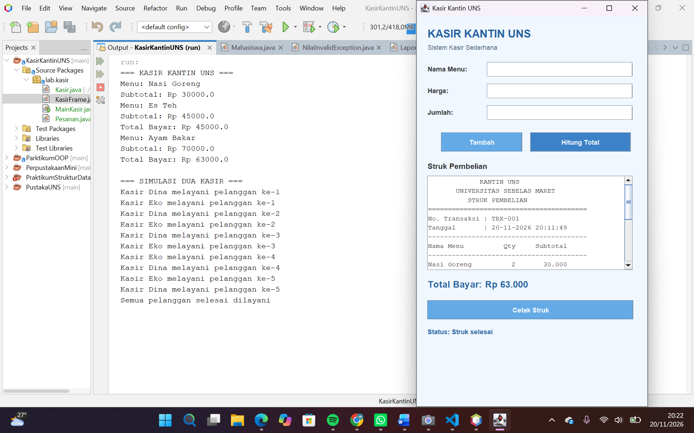

# Sistem Kasir Kantin UNS

Aplikasi kasir sederhana berbasis Java Swing dengan perhitungan diskon otomatis, simulasi dua kasir menggunakan multithreading, dan simulasi pencetakan struk.

## Daftar Isi

- [Identitas](#identitas)
- [Deskripsi Program](#deskripsi-program)
- [Teknologi](#teknologi)
- [Struktur Project](#struktur-project)
- [Penjelasan Class](#penjelasan-class)
- [Fitur Program](#fitur-program)
- [Implementasi Materi Praktikum](#implementasi-materi-praktikum)
- [Cara Menjalankan Program](#cara-menjalankan-program)
- [Output Program](#output-program)
- [Catatan](#catatan)

## Identitas

| | |
|---|---|
| Nama | Faradilla Zahrotul Ashifa |
| NIM | L0325023 |
| Kelas | 3B |
| Program Studi | Informatika |
| Mata Kuliah | Pemrograman Berorientasi Objek (PBO) |

## Deskripsi Program

Sistem Kasir Kantin UNS dibuat untuk memenuhi praktikum PBO pertemuan 11 dan 12. Program ini menerapkan enkapsulasi, multithreading, dan GUI Programming menggunakan Java Swing.

Pengguna memasukkan nama menu, harga, dan jumlah pesanan. Program menghitung subtotal dan total pembayaran. Jika subtotal lebih dari Rp50.000, pelanggan mendapat diskon 10%. Program juga menyediakan simulasi dua kasir yang melayani pelanggan secara bersamaan, serta simulasi pencetakan struk yang berjalan pada thread terpisah.

## Teknologi

| Komponen | Keterangan |
|---|---|
| Bahasa | Java |
| GUI | Java Swing |
| IDE | NetBeans |
| Package | `lab.kasir` |
| Tema tampilan | Minimalist modern, biru muda dan putih |

## Struktur Project

```text
KasirKantinUNS/
├── src/
│   └── lab/
│       └── kasir/
│           ├── Pesanan.java
│           ├── Kasir.java
│           ├── MainKasir.java
│           └── KasirFrame.java
├── nbproject/
├── build.xml
├── manifest.mf
├── Output.png
└── README.md
```

Ringkasan peran tiap class:

| Class | Peran |
|---|---|
| `Pesanan` | Mengelola subtotal, diskon, dan total pembayaran |
| `Kasir` | Thread untuk simulasi kasir yang melayani pelanggan |
| `MainKasir` | Class utama untuk pengujian dan menjalankan aplikasi |
| `KasirFrame` | Tampilan GUI dan pengelolaan struk |

## Penjelasan Class

### Pesanan.java

Class ini mengelola perhitungan transaksi. Atribut `subtotal` bersifat `private` sebagai penerapan enkapsulasi, sehingga nilainya hanya dapat diakses melalui method di dalam class.

| Method | Fungsi |
|---|---|
| `tambahItem()` | Menambahkan hasil perkalian harga dan jumlah ke subtotal |
| `getSubtotal()` | Mengembalikan nilai subtotal |
| `hitungTotal()` | Menghitung total pembayaran, dengan diskon 10% jika subtotal lebih dari Rp50.000 |
| `reset()` | Mengembalikan subtotal menjadi nol |

### Kasir.java

Class ini merupakan turunan dari class `Thread` dan digunakan untuk menyimulasikan kasir yang melayani pelanggan. Setiap objek kasir memiliki nama.

Method `run()` berisi proses melayani lima pelanggan. Setiap pelanggan dilayani dengan menampilkan nama kasir dan nomor pelanggan, kemudian `Thread.sleep(500)` memberikan jeda 500 milidetik.

### MainKasir.java

Class ini adalah class utama yang dijalankan pertama kali. Alur kerjanya terdiri dari tiga bagian:

1. Pengujian class `Pesanan` dengan data Nasi Goreng, Es Teh, dan Ayam Bakar.
2. Simulasi dua kasir, yaitu Dina dan Eko, yang dijalankan dengan `start()`. Method `join()` dipakai agar program menunggu kedua thread selesai sebelum menampilkan pesan bahwa seluruh pelanggan selesai dilayani.
3. Membuka jendela aplikasi `KasirFrame` melalui `SwingUtilities.invokeLater()`.

### KasirFrame.java

Class ini membuat tampilan aplikasi menggunakan Java Swing dan merupakan turunan dari `JFrame`. Komponen disusun menggunakan `setBounds()`.

Komponen yang digunakan:

| Komponen | Kegunaan |
|---|---|
| `JLabel` | Judul, keterangan, total bayar, dan status |
| `JTextField` | Input nama menu, harga, dan jumlah |
| `JButton` | Tombol Tambah, Hitung Total, dan Cetak Struk |
| `JTextArea` dan `JScrollPane` | Area tampilan struk |
| `JOptionPane` | Pesan peringatan dan validasi |

Pengelolaan data pesanan:

- Setiap pesanan yang ditambahkan disimpan sebagai objek `ItemPesanan` (inner class berisi nama, harga, dan jumlah) di dalam `ArrayList`. Daftar ini digunakan untuk menampilkan rincian pada struk.
- Perhitungan subtotal dan total tetap dilakukan oleh class `Pesanan`.
- Setiap jendela memiliki nomor transaksi otomatis dengan format `TRX-001`, `TRX-002`, dan seterusnya.

Method utama:

| Method | Fungsi |
|---|---|
| `tambahPesanan()` | Memvalidasi input, menambahkan item ke pesanan, lalu mengosongkan kolom input |
| `tampilkanDaftarSementara()` | Menampilkan daftar pesanan sementara pada area struk |
| `hitungTotal()` | Menghitung total pembayaran dan menampilkannya pada label total |
| `buatIsiStruk()` | Menyusun isi struk lengkap |
| `cetakStruk()` | Menjalankan simulasi pencetakan menggunakan thread |

## Fitur Program

- Input nama menu, harga, dan jumlah pesanan.
- Perhitungan subtotal otomatis untuk setiap item yang ditambahkan.
- Diskon 10% jika subtotal lebih dari Rp50.000.
- Daftar pesanan sementara pada area struk.
- Struk lengkap berisi identitas Kantin UNS, nomor transaksi, tanggal dan waktu, daftar pesanan, subtotal, diskon, dan total bayar.
- Total dihitung otomatis jika tombol Cetak Struk ditekan sebelum Hitung Total.
- Simulasi pencetakan struk dengan status yang berubah selama proses.
- Simulasi dua kasir yang bekerja bersamaan.

Validasi input yang tersedia:

| Kondisi | Pesan |
|---|---|
| Ada kolom yang kosong | Semua field harus diisi |
| Harga atau jumlah kurang dari atau sama dengan 0 | Harga dan jumlah harus lebih dari 0 |
| Harga bukan angka atau jumlah bukan bilangan bulat | Input tidak valid |
| Hitung total atau cetak struk tanpa pesanan | Belum ada pesanan |

## Implementasi Materi Praktikum

### Pertemuan 11 - Multithreading

**Simulasi dua kasir.** Class `Kasir` mewarisi `Thread`. Kasir Dina dan Kasir Eko dijalankan dengan `start()`, masing-masing melayani lima pelanggan dengan jeda `sleep()` 500 milidetik. Method `join()` digunakan agar program utama menunggu kedua kasir selesai.

**Simulasi cetak struk.** Saat tombol Cetak Struk ditekan, sebuah thread baru dibuat untuk menunggu selama dua detik. Selama proses ini tombol dinonaktifkan dan status berubah menjadi "Mencetak struk...". GUI tetap responsif karena proses menunggu tidak berjalan pada thread utama. Setelah dua detik, perubahan tampilan dikembalikan ke thread GUI melalui `SwingUtilities.invokeLater()`, kemudian status menjadi "Struk selesai" dan struk lengkap ditampilkan.

### Pertemuan 12 - GUI Programming

GUI dibuat dengan Java Swing menggunakan `JFrame`, `JLabel`, `JTextField`, `JTextArea`, `JButton`, `JScrollPane`, dan `JOptionPane`. Setiap tombol memiliki event handler (`ActionListener`) yang memanggil method tambah pesanan, hitung total, atau cetak struk. Kesalahan format angka ditangani menggunakan `try-catch` pada `NumberFormatException`.

## Cara Menjalankan Program

1. Buka project `KasirKantinUNS` di NetBeans.
2. Pastikan keempat class berada dalam package `lab.kasir`.
3. Jalankan `MainKasir.java` (klik kanan, pilih Run File).
4. Lihat hasil pengujian dan simulasi dua kasir pada tab Output.
5. Setelah simulasi selesai, jendela Kasir Kantin UNS akan terbuka.
6. Isi nama menu, harga (angka tanpa titik atau koma), dan jumlah, lalu tekan **Tambah**.
7. Tekan **Hitung Total** untuk melihat total pembayaran.
8. Tekan **Cetak Struk** untuk menjalankan simulasi pencetakan.

## Output Program

### 1. Pengujian Perhitungan

Data pengujian:

| Menu | Harga | Jumlah |
|---|---:|---:|
| Nasi Goreng | Rp15.000 | 2 |
| Es Teh | Rp5.000 | 3 |
| Ayam Bakar | Rp25.000 | 1 |

Hasil perhitungan:

| Setelah menambah | Subtotal | Diskon | Total Bayar |
|---|---:|---:|---:|
| Nasi Goreng | Rp30.000 | - | - |
| Es Teh | Rp45.000 | Tidak ada | Rp45.000 |
| Ayam Bakar | Rp70.000 | Rp7.000 (10%) | Rp63.000 |

### 2. Simulasi Dua Kasir

Output NetBeans menampilkan Kasir Dina dan Kasir Eko yang melayani pelanggan ke-1 sampai ke-5. Urutan tampilan keduanya dapat berbeda pada setiap eksekusi karena kedua thread berjalan bersamaan. Setelah keduanya selesai, program menampilkan pesan "Semua pelanggan selesai dilayani".

### 3. Tampilan GUI dan Struk

Jendela aplikasi berisi form input pesanan, tombol Tambah dan Hitung Total, area struk, label total bayar, tombol Cetak Struk, dan label status. Saat tombol Cetak Struk ditekan, status berubah menjadi "Mencetak struk...". Setelah dua detik, status menjadi "Struk selesai" dan struk lengkap tampil pada area struk.



## Catatan

Fitur Cetak Struk merupakan simulasi menggunakan multithreading dan belum terhubung dengan printer fisik.
