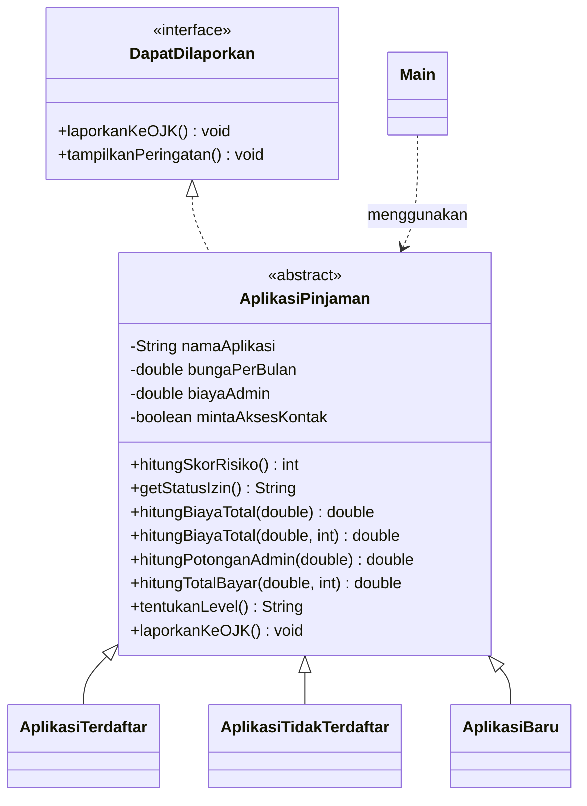

# Detektor Pinjol Mencurigakan

**Lab Session 2 - Pengembangan Program Berbasis Object-Oriented Programming (OOP)**

## Identitas

| | |
|---|---|
| Nama | Faradilla Zahrotul Ashifa |
| NIM |L0325023 |
| Kelas |3B |
| Program Studi |Informatika |
| Universitas | Universitas Sebelas Maret |
| Mata Kuliah | Praktikum Pemrograman Berorientasi Objek |
| Tugas | Lab Session 2 |

## Tentang Tugas

Lab Session 2 meminta mahasiswa membuat program Java dengan tema bebas yang menerapkan konsep Pemrograman Berorientasi Objek (OOP), yaitu encapsulation, inheritance, polymorphism, abstract class, dan interface. Program tidak harus berbentuk aplikasi kompleks, tetapi harus memiliki struktur class, object, atribut, dan method yang jelas serta memenuhi seluruh ketentuan tugas.

Studi kasus yang dipilih adalah **Detektor Pinjol Mencurigakan**, yaitu program konsol untuk menilai tingkat risiko sebuah aplikasi pinjaman online. Tema ini dipilih karena dekat dengan permasalahan masyarakat saat ini, yaitu maraknya pinjaman online ilegal dan rendahnya literasi keuangan digital.

---

## Daftar Isi

0. [Identitas dan Tentang Tugas](#identitas)
1. [Deskripsi Program](#1-deskripsi-program)
2. [Fitur](#2-fitur)
3. [Struktur Proyek](#3-struktur-proyek)
4. [Diagram Class](#4-diagram-class)
5. [Logika Penilaian Risiko](#5-logika-penilaian-risiko)
6. [Pemenuhan Ketentuan Tugas](#6-pemenuhan-ketentuan-tugas)
7. [Cara Menjalankan Program](#7-cara-menjalankan-program)
8. [Kode Program](#8-kode-program)
9. [Contoh Output](#9-contoh-output)
10. [Catatan](#10-catatan)

---

## 1. Deskripsi Program

Maraknya pinjaman online ilegal membuat banyak orang terjebak bunga yang mencekik, biaya admin yang dipotong di muka, hingga penyebaran data kontak saat penagihan. Program ini membantu pengguna mengecek sebuah aplikasi pinjaman **sebelum** dipakai.

Pengguna mengisi ciri-ciri aplikasi, yaitu nama, status izin, bunga per bulan, biaya admin, dan apakah aplikasi meminta akses kontak atau galeri. Program kemudian:

- menghitung **skor risiko** (0 sampai 100),
- menentukan **level bahaya** (AMAN, WASPADA, atau BAHAYA),
- menghitung uang yang benar-benar diterima, total bayar, dan biaya total,
- menampilkan **peringatan** yang sesuai dengan jenis aplikasi,
- menyediakan simulasi **pelaporan ke OJK** untuk aplikasi yang berisiko.

Pengguna dapat mengecek banyak aplikasi melalui menu berulang, lalu melihat ringkasan seluruh hasil pengecekan.

## 2. Fitur

- Menu interaktif dengan perulangan (cek aplikasi, ringkasan, keluar).
- Tiga jenis aplikasi dengan aturan penilaian berbeda: terdaftar OJK, tidak terdaftar, dan baru.
- Perhitungan biaya riil pinjaman, termasuk potongan admin di muka.
- Peringatan otomatis sesuai kondisi aplikasi.
- Simulasi pelaporan ke OJK.
- Ringkasan hasil seluruh aplikasi yang sudah dicek.
- Validasi input, sehingga salah ketik tidak membuat program berhenti.

## 3. Struktur Proyek

```
detektorpinjol/
 |-- DapatDilaporkan.java          (interface)
 |-- AplikasiPinjaman.java         (abstract class / superclass)
 |-- AplikasiTerdaftar.java        (subclass 1)
 |-- AplikasiTidakTerdaftar.java   (subclass 2)
 |-- AplikasiBaru.java             (subclass 3)
 `-- Main.java                     (class utama dan menu)
```

| File | Jenis | Peran |
|---|---|---|
| `DapatDilaporkan` | interface | Kontrak untuk pelaporan dan peringatan |
| `AplikasiPinjaman` | abstract class | Superclass: atribut, perhitungan biaya, penentuan level |
| `AplikasiTerdaftar` | class | Aplikasi berizin OJK, skor dasar rendah |
| `AplikasiTidakTerdaftar` | class | Aplikasi tanpa izin, skor dasar tinggi |
| `AplikasiBaru` | class | Aplikasi yang izinnya belum jelas, skor dasar sedang |
| `Main` | class | Menu, input pengguna, dan penyimpanan hasil |

## 4. Diagram Class



Jika diagram di atas tidak tampil di editor Anda, berikut bentuk teksnya:

```
DapatDilaporkan (interface)
      ^
      | implements
AplikasiPinjaman (abstract)
      ^
      | extends
      |-- AplikasiTerdaftar
      |-- AplikasiTidakTerdaftar
      `-- AplikasiBaru
```

## 5. Logika Penilaian Risiko

Skor risiko dimulai dari skor dasar sesuai jenis aplikasi, lalu bertambah jika ditemukan faktor risiko. Skor dibatasi maksimal 100.

| Faktor | Terdaftar | Tidak Terdaftar | Baru |
|---|---|---|---|
| Skor dasar | 10 | 50 | 30 |
| Bunga tinggi (di atas 5% per bulan) | +20 | +15 | +20 |
| Admin tinggi (di atas 10%) | +15 | +15 | +15 |
| Meminta akses kontak/galeri | +25 | +20 | +25 |

Penentuan level:

| Rentang skor | Level |
|---|---|
| 0 sampai 30 | AMAN |
| 31 sampai 60 | WASPADA |
| 61 sampai 100 | BAHAYA |

Rumus perhitungan biaya:

```
Potongan admin = pinjaman x admin% 
Uang diterima  = pinjaman - potongan admin
Bunga          = pinjaman x bunga% x tenor
Total bayar    = pinjaman + bunga
Biaya total    = potongan admin + bunga
```

Seluruh angka batas dan persentase di atas adalah asumsi untuk keperluan simulasi dan dapat disesuaikan pada konstanta `BATAS_BUNGA_TINGGI` dan `BATAS_ADMIN_TINGGI` di `AplikasiPinjaman.java`.

## 6. Pemenuhan Ketentuan Tugas

### Ketentuan wajib

| Konsep | Ketentuan | Penerapan dalam program |
|---|---|---|
| Encapsulation | Access modifier `private` | Atribut `namaAplikasi`, `bungaPerBulan`, `biayaAdmin`, `mintaAksesKontak` pada `AplikasiPinjaman` |
| | Getter dan setter | `getBungaPerBulan()`, `setBungaPerBulan()`, dan seterusnya |
| | Perubahan data lewat method | Setter memvalidasi nilai, misalnya menolak bunga negatif |
| Inheritance | Minimal 1 superclass dan 2 subclass | `AplikasiPinjaman` dengan 3 subclass |
| | Keyword `extends` | `class AplikasiTerdaftar extends AplikasiPinjaman` |
| | Constructor dan `super()` | Constructor tiap subclass memanggil `super(nama, bunga, admin, kontak)` |
| Polymorphism | Overriding dengan `@Override` | `hitungSkorRisiko()`, `getStatusIzin()`, `tampilkanPeringatan()` pada tiap subclass |
| | Overloading | `hitungBiayaTotal(pinjaman)` dan `hitungBiayaTotal(pinjaman, tenor)` |
| | Runtime polymorphism | `AplikasiPinjaman app = new AplikasiTidakTerdaftar(...)` dan `ArrayList<AplikasiPinjaman>` yang diproses dalam satu loop |
| Abstract class | Minimal 1 abstract class | `AplikasiPinjaman` |
| | Minimal 1 abstract method | `hitungSkorRisiko()` dan `getStatusIzin()` |
| | Subclass mengimplementasikan | Ketiga subclass meng-override kedua method tersebut |
| Interface | Minimal 1 interface | `DapatDilaporkan` |
| | Keyword `implements` | `abstract class AplikasiPinjaman implements DapatDilaporkan` |
| | Memenuhi kontrak | `laporkanKeOJK()` diimplementasikan di superclass, `tampilkanPeringatan()` di setiap subclass |

### Ketentuan tambahan

| Ketentuan | Penerapan |
|---|---|
| Minimal 4 class termasuk Main | 5 class (`Main`, `AplikasiPinjaman`, `AplikasiTerdaftar`, `AplikasiTidakTerdaftar`, `AplikasiBaru`) dan 1 interface |
| Minimal 4 objek | Setiap pengecekan aplikasi membuat 1 objek baru. Contoh output menampilkan 4 objek |
| Dapat dijalankan dengan output sesuai studi kasus | Lihat bagian Contoh Output |
| Hubungan logis superclass, subclass, dan interface | Superclass dan subclass memodelkan jenis aplikasi pinjaman, interface mendefinisikan kemampuan untuk dilaporkan dan diberi peringatan |

## 7. Cara Menjalankan Program

### Prasyarat

- JDK 8 atau lebih baru. Cek dengan perintah `java -version` dan `javac -version`.

### Menjalankan lewat terminal

Buka terminal pada folder yang **berisi** folder `detektorpinjol`, lalu jalankan:

```
javac -d out detektorpinjol/*.java
java -cp out detektorpinjol.Main
```

Penjelasan perintah:

- `javac -d out detektorpinjol/*.java` mengompilasi seluruh file dan menaruh hasilnya di folder `out`.
- `java -cp out detektorpinjol.Main` menjalankan class `Main` dari package `detektorpinjol`.

### Menjalankan lewat IDE

1. Buka folder proyek di IntelliJ IDEA, Eclipse, NetBeans, atau VS Code.
2. Pastikan folder `detektorpinjol` berada di dalam folder source (`src`).
3. Buka `Main.java`, lalu jalankan (Run).

### Menjalankan tanpa package

Jika diminta tidak memakai package, hapus baris `package detektorpinjol;` pada paling atas setiap file, simpan semua file dalam satu folder, lalu jalankan:

```
javac *.java
java Main
```

### Cara menggunakan

1. Pilih menu **1** untuk mengecek aplikasi, lalu isi data yang diminta.
2. Baca skor, level, rincian biaya, dan peringatan yang ditampilkan.
3. Jika aplikasi berisiko, pilih `y` untuk mensimulasikan pelaporan ke OJK.
4. Ulangi untuk aplikasi lain, lalu pilih menu **2** untuk melihat ringkasan.
5. Pilih menu **3** untuk keluar.

Keterangan input:

| Input | Keterangan |
|---|---|
| Status izin | 1 = terdaftar OJK, 2 = tidak terdaftar, 3 = baru atau belum jelas |
| Bunga per bulan | Dalam persen, contoh `2` berarti 2% per bulan |
| Biaya admin | Dalam persen dari pinjaman, dipotong di muka |
| Akses kontak/galeri | `y` jika aplikasi memintanya, `n` jika tidak |
| Simulasi pinjaman | Nominal dalam rupiah, tanpa titik |
| Tenor | Lama pinjaman dalam bulan |

## 8. Kode Program

Seluruh kode sumber tersedia sebagai file terpisah di repositori ini:

| File | Keterangan |
|---|---|
| [`DapatDilaporkan.java`](DapatDilaporkan.java) | Interface |
| [`AplikasiPinjaman.java`](AplikasiPinjaman.java) | Abstract class (superclass) |
| [`AplikasiTerdaftar.java`](AplikasiTerdaftar.java) | Subclass 1 |
| [`AplikasiTidakTerdaftar.java`](AplikasiTidakTerdaftar.java) | Subclass 2 |
| [`AplikasiBaru.java`](AplikasiBaru.java) | Subclass 3 |
| [`Main.java`](Main.java) | Class utama dan menu |

## 9. Contoh Output

Berikut hasil eksekusi nyata dengan 4 aplikasi yang berbeda (4 objek), mencakup level BAHAYA, AMAN, dan WASPADA.

```
===== DETEKTOR PINJOL MENCURIGAKAN =====
1. Cek aplikasi pinjaman
2. Lihat ringkasan hasil
3. Keluar
Pilih menu: 1

Nama aplikasi                    : CepatCair Pro
Status izin (1.Terdaftar OJK 2.Tidak terdaftar 3.Baru/belum jelas): 2
Bunga per bulan (%)              : 15
Biaya admin (%)                  : 25
Minta akses kontak/galeri? (y/n) : y
Simulasi pinjaman (Rp)           : 1000000
Tenor (bulan)                    : 1

------------------------------------------------
Aplikasi       : CepatCair Pro
Status         : TIDAK TERDAFTAR OJK
Skor risiko    : 100 / 100
Level          : BAHAYA
Uang diterima  : Rp 750.000   (admin Rp 250.000 dipotong di muka)
Total bayar    : Rp 1.150.000
Biaya total    : Rp 400.000 (40.0% dalam 1 bulan)
------------------------------------------------
!! PERINGATAN !!
 - Aplikasi tidak terdaftar di OJK, JANGAN dipakai.
 - Meminta akses kontak, rawan penyebaran data & teror penagihan.
 - Bunga dan admin jauh di atas kewajaran.
Laporkan ke OJK? (y/n): y
>> Laporan terkirim (simulasi) untuk aplikasi "CepatCair Pro".
   Kontak resmi: 157 / ojk.go.id

===== DETEKTOR PINJOL MENCURIGAKAN =====
1. Cek aplikasi pinjaman
2. Lihat ringkasan hasil
3. Keluar
Pilih menu: 1

Nama aplikasi                    : DanaKita
Status izin (1.Terdaftar OJK 2.Tidak terdaftar 3.Baru/belum jelas): 1
Bunga per bulan (%)              : 2
Biaya admin (%)                  : 3
Minta akses kontak/galeri? (y/n) : n
Simulasi pinjaman (Rp)           : 1000000
Tenor (bulan)                    : 3

------------------------------------------------
Aplikasi       : DanaKita
Status         : TERDAFTAR OJK
Skor risiko    : 10 / 100
Level          : AMAN
Uang diterima  : Rp 970.000   (admin Rp 30.000 dipotong di muka)
Total bayar    : Rp 1.060.000
Biaya total    : Rp 90.000 (9.0% dalam 3 bulan)
------------------------------------------------

Catatan: tetap verifikasi izin di ojk.go.id sebelum meminjam.

===== DETEKTOR PINJOL MENCURIGAKAN =====
1. Cek aplikasi pinjaman
2. Lihat ringkasan hasil
3. Keluar
Pilih menu: 1

Nama aplikasi                    : TunaiBahagia
Status izin (1.Terdaftar OJK 2.Tidak terdaftar 3.Baru/belum jelas): 1
Bunga per bulan (%)              : 7
Biaya admin (%)                  : 12
Minta akses kontak/galeri? (y/n) : n
Simulasi pinjaman (Rp)           : 1500000
Tenor (bulan)                    : 6

------------------------------------------------
Aplikasi       : TunaiBahagia
Status         : TERDAFTAR OJK
Skor risiko    : 45 / 100
Level          : WASPADA
Uang diterima  : Rp 1.320.000   (admin Rp 180.000 dipotong di muka)
Total bayar    : Rp 2.130.000
Biaya total    : Rp 810.000 (54.0% dalam 6 bulan)
------------------------------------------------
!! PERINGATAN !!
 - Bunga di atas batas wajar meski terdaftar.
 - Biaya admin terlalu besar.
Laporkan ke OJK? (y/n): n

===== DETEKTOR PINJOL MENCURIGAKAN =====
1. Cek aplikasi pinjaman
2. Lihat ringkasan hasil
3. Keluar
Pilih menu: 1

Nama aplikasi                    : DompetBaru
Status izin (1.Terdaftar OJK 2.Tidak terdaftar 3.Baru/belum jelas): 3
Bunga per bulan (%)              : 4
Biaya admin (%)                  : 6
Minta akses kontak/galeri? (y/n) : y
Simulasi pinjaman (Rp)           : 2000000
Tenor (bulan)                    : 2

------------------------------------------------
Aplikasi       : DompetBaru
Status         : BARU / BELUM TERVERIFIKASI
Skor risiko    : 55 / 100
Level          : WASPADA
Uang diterima  : Rp 1.880.000   (admin Rp 120.000 dipotong di muka)
Total bayar    : Rp 2.160.000
Biaya total    : Rp 280.000 (14.0% dalam 2 bulan)
------------------------------------------------
!! PERINGATAN !!
 - Izin belum terverifikasi, cek dulu di ojk.go.id atau WA OJK 081-157-157-157.
 - Meminta akses kontak, sangat berisiko untuk aplikasi baru.
Laporkan ke OJK? (y/n): n

===== DETEKTOR PINJOL MENCURIGAKAN =====
1. Cek aplikasi pinjaman
2. Lihat ringkasan hasil
3. Keluar
Pilih menu: 2

===== RINGKASAN HASIL PENGECEKAN =====
No  Aplikasi            Skor   Level
1   CepatCair Pro       100    BAHAYA
2   DanaKita            10     AMAN
3   TunaiBahagia        45     WASPADA
4   DompetBaru          55     WASPADA
Total dicek: 4 | Bahaya: 1 | Waspada: 2 | Aman: 1

===== DETEKTOR PINJOL MENCURIGAKAN =====
1. Cek aplikasi pinjaman
2. Lihat ringkasan hasil
3. Keluar
Pilih menu: 3

Terima kasih. Selalu cek legalitas pinjaman di ojk.go.id atau hubungi 157.
```

## 10. Catatan

- Program ini adalah **simulasi untuk keperluan edukasi**. Skor, batas bunga, dan biaya adalah asumsi, bukan standar resmi OJK.
- Fitur pelaporan ke OJK hanya mencetak pesan simulasi dan tidak mengirim data apa pun.
- Untuk memastikan legalitas pinjaman yang sebenarnya, cek daftar penyelenggara resmi di [ojk.go.id](https://ojk.go.id) atau hubungi kontak OJK 157.
